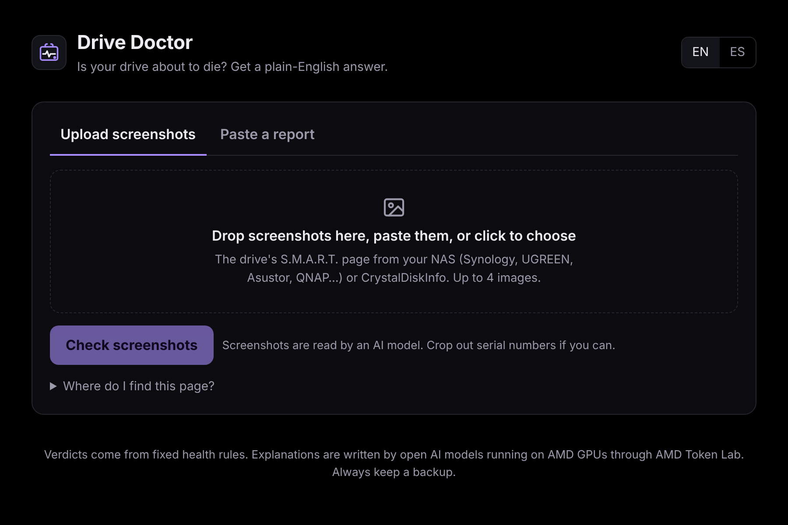
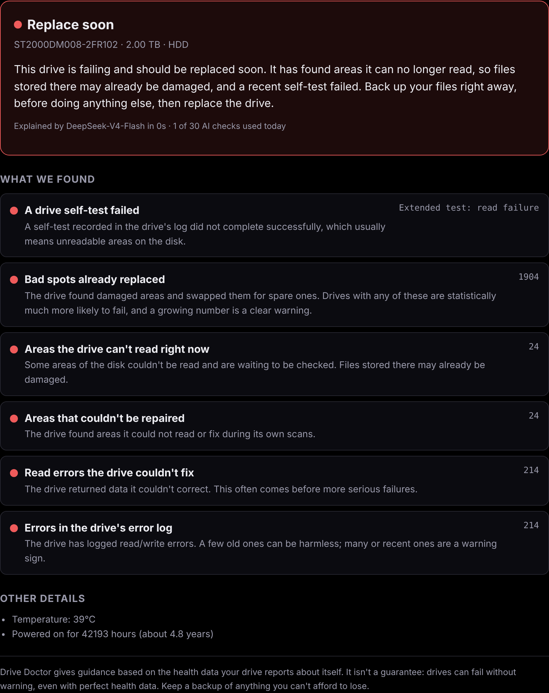
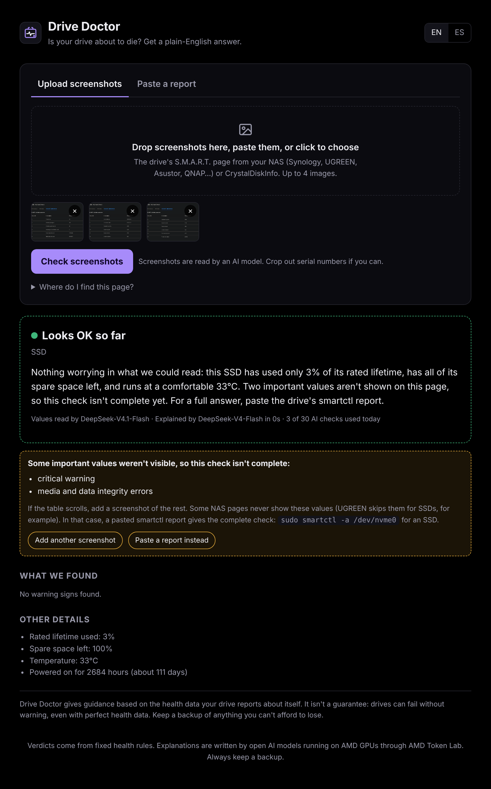
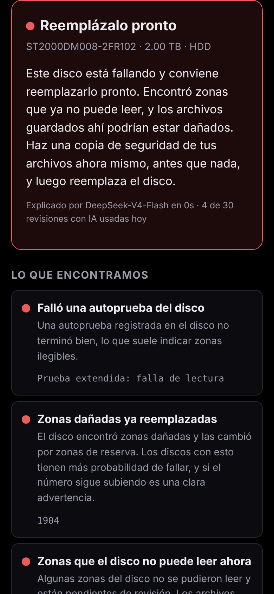

# Drive Doctor

**Is your drive about to die? Get a plain-English answer.**

Drive Doctor reads a hard drive or SSD's health data (S.M.A.R.T.) and tells you, in plain English or Spanish, whether the drive is **healthy**, needs **watching**, or should be **replaced soon**, and what to do next.

Paste a `smartctl` report, or just upload screenshots of your NAS's drive health page. No command line needed.

**Try it: [drive.scavenger.pro](https://drive.scavenger.pro)**



## Why it exists

Most people never look at their drive's health data, and the ones who do get a table of numbers like `Current_Pending_Sector 24` with no idea whether that's fine or an emergency. Drive Doctor turns that table into a clear verdict, explains the one or two numbers that matter, and puts "back up your files" first whenever there's real risk.

## How it works

```
report or screenshots
        │
        ├─ pasted report ─────► parser (smartctl -a / -x, SATA, NVMe)
        │
        └─ screenshots ───────► vision model reads the numbers
                                 ├─ row-label check (rejects misread rows)
                                 └─ second opinion on any warning
                                        │
                                        ▼
                         fixed health rules  ──►  verdict
                                        │
                                        ▼
                         text model explains it in plain words
```

**The AI never decides the verdict.** Fixed, testable rules do: reallocated, pending and uncorrectable sectors, failed self-tests, SSD wear and spare space, NVMe critical warnings, temperature, and age. The AI only does two jobs:

1. **Reading screenshots** (vision model): it copies numbers off the image. It never judges.
2. **Explaining the result** (text model): 3 to 5 plain sentences, never contradicting the verdict and never inventing causes.



## Built to not cry wolf, and not miss a dying drive

Telling someone a healthy drive is dying is a real failure. So is telling them a dying drive is fine. A few things guard against both:

- **Row-label check.** For every number read from a screenshot, the model must also report the row name it came from. The server rejects mismatches. During testing, a model read `4678` from *"Error log entry count"* and filed it as *media errors*, which would have told a healthy SSD to be replaced. That exact case is now a permanent test.
- **Second opinion on bad news.** If a screenshot leads to any warning, a different model reads the same images independently. The warning only stands if both agree on the number.
- **"Looks OK so far," not "Healthy," when data is missing.** If key values aren't visible (cut off, or the NAS page simply doesn't show them), the result says so and lists what's missing.
- **Old errors handled carefully.** A single error logged at hour 0 (at the factory) isn't a warning, but recent errors, many errors, or drives too old to date their errors reliably are.
- **Backup model.** If the main model is busy or times out, a second model takes over. If both fail, the verdict still shows with a basic summary.



## Tested on real hardware

Real reports and screenshots from a UGREEN NAS (WD Black HDD, NVMe SSD), an Asustor NAS (SATA SSD), and a Synology NAS (WD 8TB HDD). Each one surfaced a quirk that's now handled and covered by a test:

| Drive | What it taught the app |
|---|---|
| WD Black 4TB (UGREEN) | Corrupt threshold table: ignore vendor limits when smartctl warns about them |
| Generic SATA SSD (Asustor) | One factory error at hour 0 shouldn't trigger a warning |
| WD 8TB (Synology) | Synology needs `-d sat`; lowercase "Serial number" must still be scrubbed |
| NVMe SSD (UGREEN screenshots) | The page skips critical warning and media errors, so offer a pasted report instead |

## English and Spanish

Every verdict, finding, and explanation is available in both languages.



## Privacy

- Serial numbers and drive IDs are removed from pasted reports before anything is analyzed or sent to a model.
- Screenshots are sent to the vision model, so the page asks people to crop out serial numbers, and the model is told never to output identifiers.
- Daily usage limits store salted hashes, never IP addresses. The salt changes every day.

## Powered by AMD Token Lab

The AI runs on open models served on AMD Instinct GPUs through [AMD Token Lab](https://www.amd.com/en/developer/ai-dev-program.html):

| Job | Main model | Backup |
|---|---|---|
| Explaining results | DeepSeek-V4-Flash | Gemma-4-31B-IT |
| Reading screenshots | DeepSeek-V4.1-Flash | Gemma-4-31B-IT |

Any OpenAI-compatible API works: change the base URL and model names in `.env`.

## Run it

Requires Docker.

```
cp .env.example .env              # add your API key
mkdir -p data && sudo chown 65532:65532 data
docker compose up -d --build
```

Open http://localhost:8099. Without an API key, pasted reports still get a verdict with a basic summary.

### Getting a report

- **Linux / NAS / Mac:** `sudo smartctl -a /dev/sda` (install `smartmontools` if needed)
- **Synology:** `sudo smartctl -a -d sat /dev/sata1`
- **NVMe SSD:** `sudo smartctl -a /dev/nvme0`
- **No command line:** upload screenshots of your NAS's S.M.A.R.T. page instead

### Settings

| Variable | Default | Purpose |
|---|---|---|
| `DD_AI_BASE_URL` | `https://api.tokenlab.amd.com/v1` | Any OpenAI-compatible endpoint |
| `DD_AI_API_KEY` | (none) | API key. Without it, rule-based summaries only |
| `DD_AI_MODEL` | `DeepSeek-V4-Flash` | Model for explanations |
| `DD_AI_BACKUP_MODEL` | `Gemma-4-31B-IT` | Tried once if the main model fails (`none` to disable) |
| `DD_VISION_MODEL` | `DeepSeek-V4.1-Flash` | Model for reading screenshots |
| `DD_VISION_BACKUP_MODEL` | `Gemma-4-31B-IT` | Backup reader and second opinion |
| `DD_DAILY_LIMIT` | `30` | AI checks per visitor per day (a screenshot check counts as 2; 0 = unlimited) |
| `DD_DATA_DIR` | (none) | Where daily limits are saved so they survive restarts |
| `DD_ADDR` | `:8080` | Listen address |

### Development

```
go test ./...
DD_AI_API_KEY=your-key go run .
```

Single Go binary with the web page embedded, standard library only.

## Disclaimer

Drive Doctor gives guidance based on the health data a drive reports about itself. It isn't a guarantee: drives can fail without warning, even with perfect health data. Keep a backup of anything you can't afford to lose.
